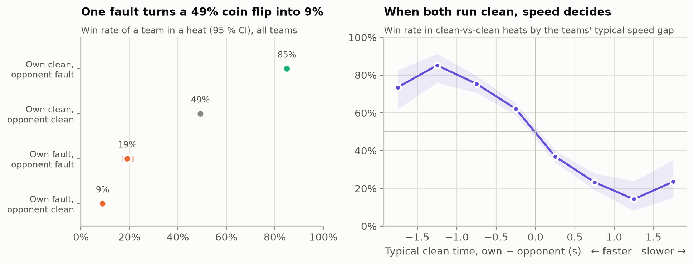
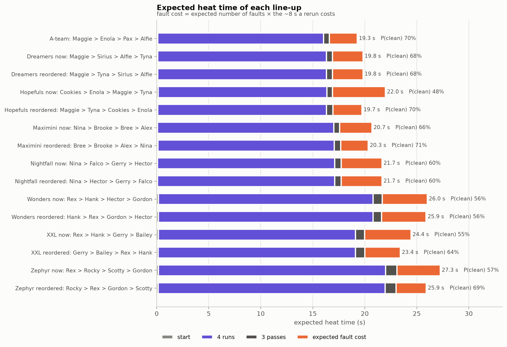
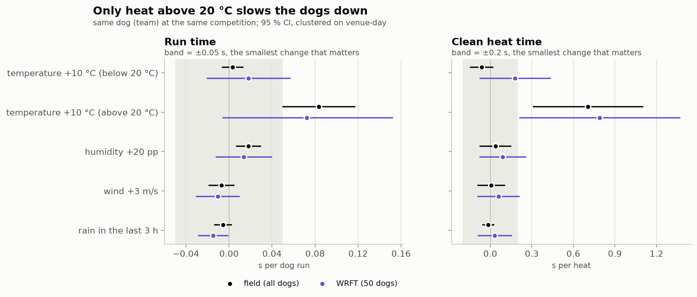

# Flyball 2023: what wins heats for the Wild Runners

A data analysis of one flyball club's 2023 racing season, from raw competition spreadsheets to a coach-ready action plan.

> **Flyball** is a relay race for dogs. Four dogs per team take turns jumping four hurdles, triggering a box that releases a ball, and racing back with it. The next dog may only cross the start line once the previous one is back. Starting too early, passing too early, or a dropped ball are faults, and the faulting dog has to run again at the end.

**Deliverables (in Hungarian, for the client):**
[presentation (PDF)](prezentacio/WRFT_2023_elemzes.pdf) ·
[speaker notes (PDF)](prezentacio/WRFT_2023_eloadoi_jegyzet.pdf) ·
[interactive website](prezentacio/index.html) (open locally; it works offline) ·
**Full findings (English):** [`reports/findings.md`](reports/findings.md)

---

## The goal

The coach of the fictional **Wild Runners Flyball Team (WRFT)** asked for help with the club's 2023 results. The brief ([`flyball_elemzes.md`](flyball_elemzes.md), in Hungarian) asked for:

1. An overall picture of the teams and dogs: run times, starts, passes and faults.
2. **Q1:** Does the **lane colour** (red or blue) affect performance?
3. **Q2:** Does it matter whether a dog passes onto an **intact or neutered male or female**?
4. **Q3:** All of the above, **per competition** (venue and date).
5. **Weather:** attach weather data to every race, and test the coach's hunch that temperature, wind, humidity and rain affect the dogs.
6. A proposal for the **ideal line-up**.

The deliverables are reproducible code and a 10–12 minute business presentation.

**The data:** three Excel workbooks. They hold 11 competitions (Czech FlyballCZ events and the European Flyball Championship in Hungary), WRFT's 7 teams and 50 dogs, among about 900 dogs in the whole field. Dog names and IDs are masked.

---

## Main results

### WRFT's dogs are fast enough. Faults cost them heats.

WRFT's dogs run a median **4.28 s**, the field **4.27 s**. Yet WRFT wins **40.8 %** of its heats against the field's **45.6 %**. The difference is faults, above all false starts (15.8 % of WRFT heats, 10.6 % in the field).

- 62 % of WRFT's losses include its own fault.
- **155 losses were avoidable**: heats WRFT would normally have won on speed.
- A fault costs about **8 s** of rerun, more than the speed gap between almost any two teams.
- Who faults explains a heat's result about **15× better** than typical speed does.



### Three levers, each worth about 27 extra wins a season

To compare every lever on the same scale, each is converted into **extra heats won per season** against other clubs. In 2023 that was 907 heats, of which WRFT won 39 %.

| Lever | Extra wins / season (95 % CI) | What it takes |
|---|---|---|
| **Better running order, same dogs** (4 teams) | **+27** (20–33) | Nothing: use it at the next competition |
| **Saturdays as clean as Sundays** | **+28** (17–42) | Find out what differs; the cause is unknown |
| **Close each team's fault gap to its peers** | **+26** (21–33) | Targeted start, pass and run training |
| Bring the best bench dog (Pax) into a team | +3 to +45 | Depends on his availability |
| Keep full speed on hot days | ≤ +3.5 | Little to gain; a welfare issue |
| Lane colour, partner's sex or neuter status | 0 | No effect found |
| *For scale: no own faults at all* | *+148* | *A ceiling, not a target* |

The levers overlap, so they don't simply add up. **About +5 percentage points of win rate in 2024** is a realistic target.

- **Running order:** most of the gain comes from *who starts*. One Hopefuls starter false-starts 37 % of the time. Moving a proven safe starter to the front saves the team over 2 s per heat on average.
- **Saturdays:** at two-day events the same teams run **16 percentage points more clean heats on day 2**, at the same speed. The difference is nerves or routine, not fitness.
- **Fault habits:** each team has one or two specific weaknesses (XXL: starts, Zephyr: runs, Hopefuls: passes), usually concentrated in a few dogs. Tighter passes don't pay. The best trade-off is a pass of 0.12–0.35 s, and WRFT is already inside that window.



### The coach's questions

| Question | Answer |
|---|---|
| **Q1: lane colour** | No effect that matters: ±0.006 s per run, well inside a ±0.05 s equivalence margin. No lane strategy is needed. |
| **Q2: partner's sex or neuter status** | No measurable effect on racing performance. One lead to check: passes onto young intact males are held back more often. |
| **Q3: per competition** | WRFT fell behind its peers on 4 of 20 competition days, every time through faults, never through speed. |
| **Weather** | Only **heat above 20 °C** matters: +0.08 s per run for every 10 °C, for all dogs alike. Humidity, wind and rain have no practical effect. Heat slows the opponents too, so it is a welfare issue rather than a results lever. |
| **Ideal line-up** | **Maggie > Enola > Pax > Alfie** (19.3 s expected per heat, 70 % chance of a clean heat). Enola, Alfie and Maggie are the stable core. |



The full ranked findings, the action plan with KPIs, the open questions and the limitations are in [`reports/findings.md`](reports/findings.md).

---

## How it was done

The analysis follows the six phases in the brief. Every step, with its reasoning and the number of rows affected, is in [`ANALYSIS_LOG.md`](ANALYSIS_LOG.md).

1. **Exploration:** reverse-engineered the spreadsheets. The lane colour exists only as the *font colour* of the team-name cell, and 19 rows are shifted by one cell. See [`data_structure.md`](data_structure.md). Flyball rules and benchmarks are collected in [`domain_knowledge.md`](domain_knowledge.md).
2. **Cleaning:** a tested parser turns the sheets into tidy tables of heats and individual runs (`data/processed/`). Censored pass times, reruns and placeholder dogs are handled explicitly.
3. **Basic analyses:** what wins a heat (a logistic model), dog scorecards with shrunken fault rates, peer benchmarks per division, and the pass-timing trade-off.
4. **Advanced analyses:**
   - lane and partner effects tested with mixed models and equivalence tests (TOST);
   - per-competition tables;
   - hourly weather from the Open-Meteo historical API, matched to each heat;
   - within-dog weather models with a 20 °C hinge, checked against gradient boosting;
   - an exhaustive line-up search over 2.7 M combinations, back-tested on autumn races (Spearman 0.91).
5. **Synthesis:** every lever converted into extra wins per season, with confidence intervals from 2,000 simulated draws of the model (the *impact ledger*).
6. **Presentation:** a 35-slide Hungarian deck, speaker notes and an interactive site with a line-up builder, all built from code. Every number on a slide comes from [`key_numbers.json`](reports/phase5/key_numbers.json), never typed in by hand.

The models describe what happened in observational data. They rank the levers reliably, but the exact numbers are estimates, not promises.

---

## Repository layout

| Path | Content |
|---|---|
| `*.xlsx`, `WRFT_dokumentacio.md` | Source data and the client's data dictionary (never modified by the code) |
| `src/flyball/` | Python package: parsing, cleaning, metrics, models, weather, line-up search, plots, report builder |
| `scripts/` | One script per phase, which rebuilds that phase's outputs |
| `notebooks/` | Narrative notebooks walking through each phase |
| `tests/` | 113 tests: parser cases, cleaning invariants, metrics, model outputs |
| `data/processed/` | Cleaned tables (heats, runs, dogs, weather) |
| `data/external/weather/` | Cached Open-Meteo responses, so the weather data is reproducible offline |
| `reports/` | Result tables per phase, dog scorecards, findings and storyline |
| `figures/` | Charts (English working charts; Hungarian deck charts in `phase6/`) |
| `prezentacio/` | The client deliverable: deck, speaker notes, interactive site, CSV downloads |

## Reproducing

Requires Python 3.12 and [uv](https://docs.astral.sh/uv/).

```bash
uv sync                                          # create the environment
uv run python scripts/run_phase2_clean.py        # Excel -> data/processed/
uv run python scripts/run_phase3_basic.py        # basic analyses
uv run python scripts/run_phase4_weather.py      # weather (from the cache)
uv run python scripts/run_phase4a.py             # lane, partner, per competition
uv run python scripts/run_phase4b.py             # weather effects, line-up
uv run python scripts/run_phase5_synthesis.py    # impact ledger, key numbers
uv run python scripts/run_phase6_presentation.py # deck, notes and site (needs headless Chromium via Playwright)
uv run pytest                                    # tests
```

---

*The team is fictional; the brief and the masked data come from a data-analysis assignment. Made with the help of Claude Code.*
